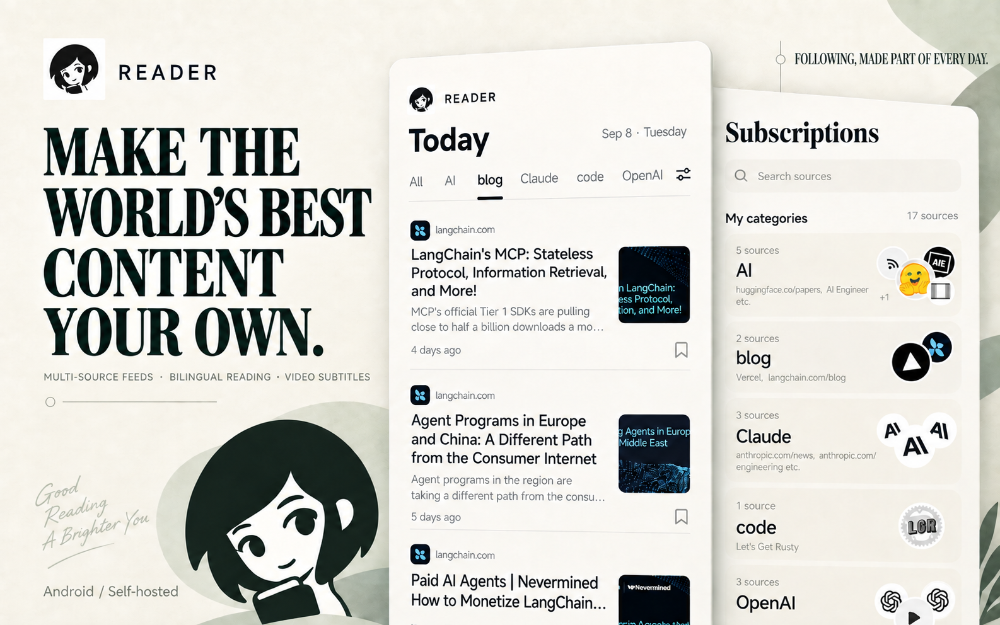
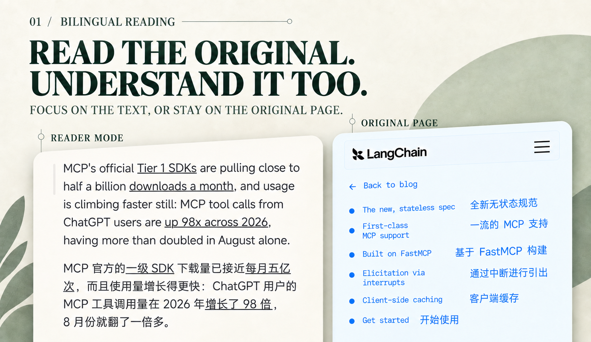
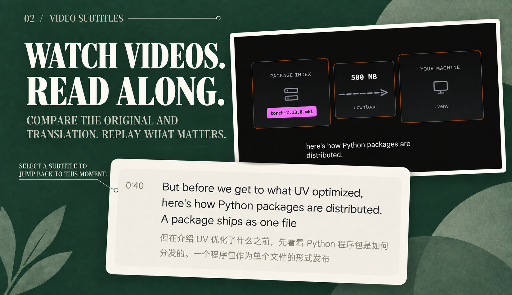

<h1 align="center">Reader</h1>

<p align="center"><strong>Bring what you follow together. Read it in a language you know.</strong></p>

<p align="center">Multi-source subscriptions · Trending rankings · Bilingual web reading · YouTube subtitle translation · Self-hosted</p>

<p align="center"><a href="README.md">简体中文</a> · <strong>English</strong></p>

<p align="center">
  <a href="#getting-started">Getting Started</a> ·
  <a href="#current-release-status">Current Status</a> ·
  <a href="#reading-experience">Reading Experience</a> ·
  <a href="#trending-rankings">Trending Rankings</a> ·
  <a href="#sources-and-discovery">Supported Sources</a> ·
  <a href="docs/deployment.md">Deployment Guide</a>
</p>

<p align="center">
  
</p>

Reader is a self-hosted information aggregation app. Bring blogs, communities, websites, and video channels into one reading space, organize subscriptions around your interests, read translations alongside the original text, and save content worth revisiting.

- **Make following a daily habit.** Updates from multiple sources flow into the Today timeline. Organize your reading topics with folders, or discover something new through trending rankings.
- **Understand more, then go deeper.** Titles in your feed and in the rankings are translated automatically according to your settings. Read web pages in the original or side by side with a translation. For YouTube videos, follow the subtitle timeline, jump to a line, and replay it.
- **Connect to your own service.** Subscriptions, saved items, and accounts live on the Reader service you connect to. The service operator configures the translation models.

## Current release status

> [!WARNING]
> Reader is currently a development preview, not a production release. Known issues remain, and parts of the experience are still being refined.

- **Website subscriptions:** Only websites that publish RSS / Atom are supported for now; sites without a feed are planned for a separate web-crawling service.
- **Interface:** The client has just been redesigned; dark-mode colors and some details are still being calibrated.
- **Languages:** The interface is available in Simplified Chinese and English (follow the system or choose one); content can be translated into several languages.

## Getting started

**Android is currently the primary platform for usage and validation. Preview APKs are available from [GitHub Releases](https://github.com/ccpowe/reader/releases).** The client must connect to a Reader backend; the project does not currently provide a publicly hosted service.

1. **Prepare the service.** Follow the [deployment guide](docs/deployment.md) to configure PostgreSQL and start the Reader API and Worker. If a service is already available, ask its administrator for the service URL and connection token.
2. **Prepare the client.** Download an APK from GitHub Releases, or follow the [frontend development and APK build instructions](mobile/AGENTS.md#环境与命令), use the `preview` profile, and build an installable standalone Android APK.
3. **Start reading.** Enter the service URL and connection token on the connection screen, register or sign in to a Reader account, and add your first subscription.

The minimum deployment consists of **Reader API + Worker + PostgreSQL**. Registration does not require email verification. Translation models are optional; the service operator is responsible for server and third-party API costs.

The shortest Docker workflow is below. See the
[Docker Compose deployment guide](docs/docker-deployment.md) for full configuration, upgrades, networks,
backups, and secret boundaries.

```bash
cp .env.docker.example .env.docker
./docker-init.sh init
# Put the provider key you use in .docker/inputs/deepseek-api-key or openrouter-api-key.
./docker-init.sh up
./docker-init.sh token
```

The API listens on `127.0.0.1:8000` by default. `token` prints the connection token for the client. Provider keys, the database password, and the JWT signing secret are never added to an image or Git. Without credentials for the selected translation engine (a provider API key or an imported Codex login), subscriptions, original-content reading, rankings and saved items keep working; only translation is unavailable.

> [!CAUTION]
> **X / Scweet risk notice**
>
> - X collection is optional and currently uses the unofficial Scweet service with an X web-login cookie.
> - Create a secondary account dedicated to Reader instead of using your primary personal account. Keep its cookie only on the deployment host; never commit it to Git or send it through chat.
> - X may change its policies, pages, or enforcement at any time, and collection may trigger rate limits, login challenges, or account restrictions. This project cannot guarantee continued X availability or prevent, reverse, or recover an account restriction. Operators must assess these risks and comply with applicable policies and local law.
> - Without this configuration, only X synchronization is unavailable; other sources and reading features continue to work. See the [deployment guide](docs/deployment.md#x-内容可选scweet) for setup details.

## Reading experience

### Read the original—and understand it

<p align="center">
  
</p>

**RSS and website articles open in the original in-app web page by default**, preserving the website's content and interactions. Select Reader Mode to show the article in a consistent layout. You can switch back to the original page at any time or open it in the system browser.

Reader Mode uses the article body stored by the server when it is long enough (at least 400 characters); otherwise it extracts the article from the page currently loaded. If the page cannot be extracted or has not finished loading, Reader keeps the original page available and explains why, without stopping subscription updates. Extracted content is only used for the current reading session—it is not automatically saved for offline use or synchronized to other devices.

Switch between the original and a bilingual view, with each translated paragraph placed under its original and styled like it. Translations appear paragraph by paragraph; while they are pending, if they fail, or when the translation budget is used up, the original remains readable. The server can be configured with **DeepSeek**, **OpenRouter** or a **Codex subscription**.

### Watch a video—and read along

<p align="center">
  
</p>

Play YouTube videos in the app with a subtitle timeline below that follows playback. With translation on, the timeline shows each line with its translation, and the player can show bilingual subtitles too. **Select any subtitle to jump to that moment**, making it easy to replay something you missed.

Subtitle features depend on captions provided by the video. Reader does not currently transcribe videos that have no captions, and availability can also be affected by YouTube page and player behavior.

## Trending rankings

### Discover beyond your subscriptions

<p align="center">
  
</p>

Open Rankings and swipe between **Hacker News, Reddit, GitHub, X Tech Trends, and Product Hunt** to discover discussions, articles, open-source projects and new products beyond your subscriptions. Titles and descriptions are translated automatically according to your settings; until a translation arrives, the original is shown.

- **Hacker News:** technology articles and discussions, with score, comment count and domain.
- **Reddit:** your subscribed communities as shortcuts, or any community you type; sort by hot, rising, or top of the day/week/month/year.
- **GitHub:** daily, weekly or monthly Trending, with description, language, stars and stars gained in the period.
- **X Tech Trends:** from TechTwitter — news headlines, a short take and topic tags. No X account subscription, cookie or Scweet service is needed.
- **Product Hunt:** today's and yesterday's featured launches, by Los Angeles date. Requires an official API token on the server (see the [deployment guide](docs/deployment.md)).

Rankings are fetched from upstream only when someone opens them: each shows how old its data is; if a refresh fails the previous data stays, marked as out of date; when an upstream rate-limits Reader, fetching pauses and the reason is shown. Manual refresh is allowed once a minute per ranking.
Opening an entry takes you straight to the reader. Entries can be saved and reopened from Saved, where they show which ranking they came from.

<p align="center"><sub>These are AI-assisted editorial compositions based on screenshots from a physical Android device, not pixel-for-pixel UI screenshots. The rankings image uses Hacker News as its example. See the <a href="docs/assets/readme/README.md">asset notes</a> for the original material, versions, and sources.</sub></p>

## Sources and discovery

| Source | What you can follow | Requirements |
| --- | --- | --- |
| **RSS / Atom** | Blogs, news sites, and public feeds | Add the feed URL |
| **Websites** | Article lists from public blogs | Enter a website address and Reader finds and subscribes to its RSS / Atom feed; sites without a feed are not supported yet |
| **Reddit** | Community posts | Add a community source |
| **YouTube** | Channel updates | Optionally configure the YouTube Data API; otherwise Reader uses the public Atom feed |
| **X** | Public posts from an account | Uses Scweet and a dedicated secondary-account cookie; platform policy, rate-limit, and account-restriction risks apply |

## Let an AI client use Reader through MCP

The Reader API includes an MCP endpoint at `/mcp` (Streamable HTTP), so an AI assistant can see what is new in your subscriptions and rankings — for example to brief you on the day's AI and tech news. Reader runs no model and no schedule of its own; judging what matters, grouping topics and writing the brief are the assistant's job.

| Tool | What it does |
| --- | --- |
| `get_subscription_updates_summary` | New items per enabled subscription in a time window, optionally for one group |
| `list_updates` | New items of all enabled subscriptions in a window, newest first, 50 a page |
| `get_item` | One item's stored text (body, post or video description; text taken from HTML is capped at 20,000 characters), plus X quotes and the stored rest of a thread; missing article bodies are not fetched |
| `get_board` | A ranking's first 30 entries now (fetched on the spot if expired); GitHub daily/weekly/monthly, Product Hunt today/yesterday, Reddit needs a community |
| `get_youtube_transcript` | A public video's subtitles with timestamps, paged, untranslated; prefers the auto-generated track, otherwise the first manual one, which may not match the spoken language |
| `add_subscription` | Follows an RSS feed, website, YouTube channel, X account or Reddit community when the user explicitly asks, optionally into a group; following twice is harmless |

**Token:** the operator issues a personal MCP token for your account on the server (shown once; issuing again replaces it): `reader-admin mcp-token create you@example.com`, and `reader-admin mcp-token revoke you@example.com`. See the [Chinese README](README.md#通过-mcp-交给-ai-阅读) for the Docker form.

**Client configuration** (any client that supports remote MCP over Streamable HTTP):

```json
{
  "mcpServers": {
    "reader": {
      "type": "http",
      "url": "https://reader.example/mcp",
      "headers": {
        "X-Reader-Server-Token": "<deployment connection token>",
        "Authorization": "Bearer <personal MCP token>"
      }
    }
  }
}
```

The URL is the API base plus `/mcp`, keeping any reverse-proxy prefix; use HTTPS for a remote server. Keep both tokens in the client's private configuration, never in a committed file. Each call runs as the token's account and sees only its subscriptions; queries do not mark anything read, clear new-item badges or create translations.

Time windows are ISO 8601 with a timezone. Counts cover only the data the server still keeps (the newest items of each source), not a complete archive. Subtitle reading sends no Reader credentials and does not transcribe audio; missing or restricted captions are reported as such. MCP cannot delete subscriptions, change groups or send notifications.

## Self-hosted reading spaces, managed by service

The Android client connects to a service at runtime, so server URLs and translation credentials do not need to be embedded in the APK. Accounts, subscriptions, and saved items are stored by the connected Reader service and its database.

Download the Android preview APK from [GitHub Releases](https://github.com/ccpowe/reader/releases). The current build targets arm64-v8a devices; after installation, enter your own Reader service URL and connection token in the app.

The client connects to one Reader service at a time. Changing the server in Me means connecting again: the local session and caches are cleared, and nothing is migrated from the previous service.

## Frequently asked questions

<details>
<summary><strong>Can I use Reader without configuring a translation model?</strong></summary>

Yes. Subscriptions, original-text reading, rankings, and saved items do not depend on a translation model. When translation is needed, an administrator can configure DeepSeek or OpenRouter, and users can select an available engine in the app. See the [backend environment variable example](backend/.env.example) for configuration options.

</details>

<details>
<summary><strong>Are iOS and Web supported?</strong></summary>

The client uses Expo and React Native. Android is currently the primary platform for usage and validation. iOS and Web have not completed release-level validation, and the WebView-based reading features currently use native implementations.

</details>

<details>
<summary><strong>Can every web page be translated completely?</strong></summary>

Web translation can be affected by site layouts, sign-in state, dynamic loading, and embedded content. For an incompatible page, switch to Reader Mode where supported or continue reading in the system browser.

</details>

## Documentation and feedback

| What you want to do | Start here |
| --- | --- |
| Deploy a Reader service | [Docker Compose deployment](docs/docker-deployment.md) · [General deployment guide](docs/deployment.md) · [Backend documentation](backend/README.md) |
| Develop or build the client | [Repository development guidelines](AGENTS.md) · [Frontend and APK builds](mobile/AGENTS.md) · [Backend development](backend/AGENTS.md) |
| Understand the system design | [Architecture overview](docs/ARCHITECTURE.md) · [C4 model](architecture/workspace.dsl) |
| Inspect the API | [Reader API OpenAPI](contracts/openapi.json) |

When reporting a problem, include the app version, reproduction steps, and the affected screen. For web-page or subtitle issues, attach a public URL and screenshot when possible, without including credentials or private content.

**Public release:** The project is preparing for its first public release. Public download and feedback channels have not yet been finalized.

## License

Reader source code is released under the [MIT License](LICENSE), Copyright © 2026 ccpowe.

Third-party dependencies and assets retain their own copyright and license terms; adopting MIT for Reader does not alter them. The license notice for code originating from Expo is preserved in [mobile/LICENSE-EXPO](mobile/LICENSE-EXPO). Articles, video frames, and website marks shown in the editorial images belong to their respective sources and are not included in Reader's MIT license grant.
