# Reader 后端架构图谱

本文按当前代码绘制，从运行单元逐层下钻到模块、事务和关键算法。它是[架构说明](ARCHITECTURE.md)的图形阅读入口，不是未来重构方案，也不表示可选服务已经在线启用。

- **结构模型**：[Structurizr C1–C3](../architecture/workspace.dsl) 仍是全系统结构的维护入口；本文补充面向后端的聚焦视图与内部实现图。
- **实现权威**：每节列出实际源码与符号；不是逐类 UML 全量清单。HTTP 字段以 [OpenAPI](../contracts/openapi.json) 为准，表约束以 ORM／迁移为准。
- **读图规则**：边上标明调用、SQL、HTTP 或状态交接。虚线用于可选路径、提示或逻辑关联；不能把图中的模块框自动理解成进程或服务。
- **浏览**：使用支持 Mermaid 的 Markdown 预览。全系统 C4 静态页面由根目录 [AGENTS](../AGENTS.md#环境与常用命令) 的 Structurizr 命令导出；不手改生成页面。

## 阅读导航

| 层次 | 问题 | 图谱入口 |
| --- | --- | --- |
| 顶层运行架构 | 哪些进程运行，谁访问数据库和外部系统？ | [运行单元](#runtime)、[Worker 调度](#worker-runtime) |
| 数据归属 | 用户、来源、内容及任务由谁拥有？ | [核心关系](#data)、[持久任务边界](#durable-boundaries) |
| API 子系统 | 认证、订阅、信息流、排行、收藏和频道更新如何组合？ | [API 与用户业务](#api) |
| 内容接入 | scanner 如何推进游标，候选如何安全入库？ | [扫描与候选](#execution) |
| 规则与浏览器 | 模型如何交接规则，执行与隔离权限在哪里？ | [规则作者与交接](#rule-author)、[浏览器隔离与回收](#browser-tasks) |
| 翻译 | 标题、普通片段、实时片段及持久工作如何分流？ | [翻译与模型](#translation) |
| 运维内部实现 | 进程资源、就绪检查、保留清理怎样工作？ | [运行资源与维护](#operations) |

<a id="runtime"></a>

## 顶层：后端运行单元与外部边界

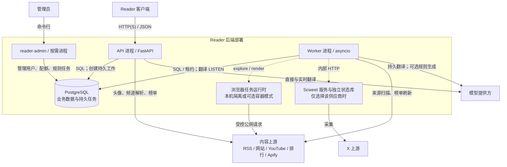

API 和 Worker 是同一 Python 代码库的不同运行实例，不通过 RPC 互相调度；持久候选和翻译／规则任务都是 PostgreSQL 中的表，不存在另一个消息队列服务。浏览器 Manager／Reaper 的 SQLite 与 Scweet 的 SQLite 均不是 Reader PostgreSQL 的替代品。

为保持顶层图可读，Codex 专用凭据文件及 OAuth 刷新单独放在后文模型构造图：API／Worker 按需续期，管理 CLI 可显式刷新；文件读写受跨进程锁保护。

源码：[API `lifespan/create_app`](../backend/src/app/main.py)、[Worker `run_forever`](../backend/src/app/workers/main.py)、[CLI](../backend/src/app/admin/cli.py)、[部署单元](../compose.yaml)。外部认证由凭据持有者的 [Codex 客户端](../backend/src/app/llm/codex_auth.py) 执行。

<a id="worker-runtime"></a>

## Worker：一个进程，多条独立后台循环

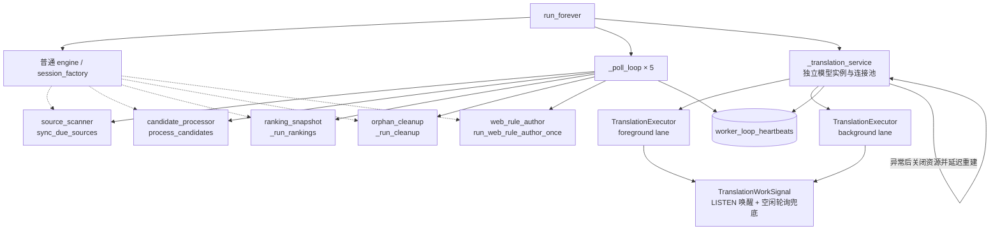

这些是进程内 asyncio 循环，不是五个微服务。前台／后台翻译 lane 按 priority 分界领取持久 Work；翻译运行时失败有自己的重建逻辑，不主动终止来源采集。普通循环记录 started／finished 心跳与错误。`run_once` 是另一条有界执行入口，不应把其调用顺序当成长驻循环之间的依赖。

源码：[循环与翻译资源监督](../backend/src/app/workers/main.py)、[心跳与汇总](../backend/src/app/workers/health.py)、[通知监听](../backend/src/app/translation/notifier.py)。

<a id="data"></a>

## 数据设计：来源拥有内容，用户拥有订阅与收藏

下图仅列核心持久关系；未展开字段和所有索引。

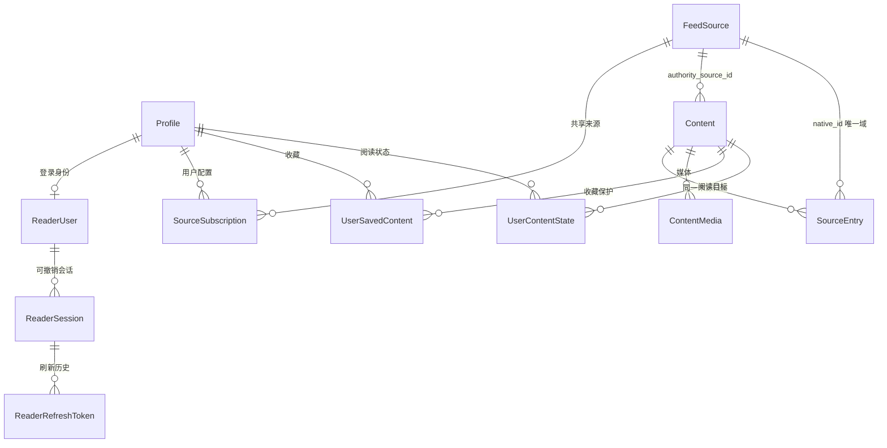

- `Content` 按 `authority_source_id + url_hash` 去重；`SourceEntry` 按 `source_id + native_id` 去重。复合外键约束条目与内容属于同一来源，不做跨来源 URL 全局归并。
- 来源共享不意味着用户配置共享。分组、启用、首页包含和更新确认游标在 `SourceSubscription`；阅读与收藏另按用户保存。
- 一个内容可以有多个上游条目标识。既有排序时间与新增提醒序号不是同一字段，修改内容也不自动生成新增提醒。

源码：[内容、订阅与关联约束](../backend/src/app/storage/models.py)、[用户与会话表](../backend/src/app/storage/auth_models.py)、[候选投影](../backend/src/app/workers/candidates.py)。

<a id="durable-boundaries"></a>

## 持久任务与状态：三个交接协议，不是一套通用工作流

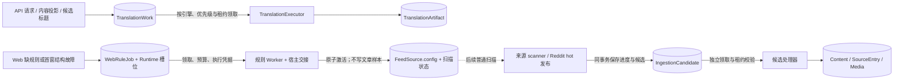

| 状态 | 权威与约束 |
| --- | --- |
| `SourceSyncState / SourceSyncRun` | 唯一来源调度与扫描进度；展示 `phase` 不能代替 continuation／初扫标记 |
| `IngestionCandidate` | 来源内条目身份、变化哈希、显式观察语义、首次基线标记、领取租约；状态是 pending／processing／completed／failed |
| `TranslationWork / TranslationArtifact` | Work 是执行状态，Artifact 是成功结果；通过翻译身份匹配，不应画成内容表的简单外键缓存 |
| `WebRuleJob / WebRuleAgentRuntime` | 来源修订绑定的规则任务、预算与全局槽位；执行凭据不等于模型内容判断 |
| `RankingSnapshot / RankingProviderBudget` | 共享快照与跨进程供应商刷新预算，API 和 Worker 均可参与 |
| 配额、schema、心跳 | PostgreSQL 配额和任务租约可跨进程协调；进程内并发器、认证限流器与实时合并不提供跨副本总限制 |

源码：[ORM](../backend/src/app/storage/models.py)、[扫描事务](../backend/src/app/workers/sync.py)、[候选队列](../backend/src/app/ingestion/candidate_queue.py)、[翻译存储](../backend/src/app/translation/store.py)、[规则任务服务](../backend/src/app/services/web_rule_jobs.py)。

<a id="api"></a>

## API 模块组合与请求边界

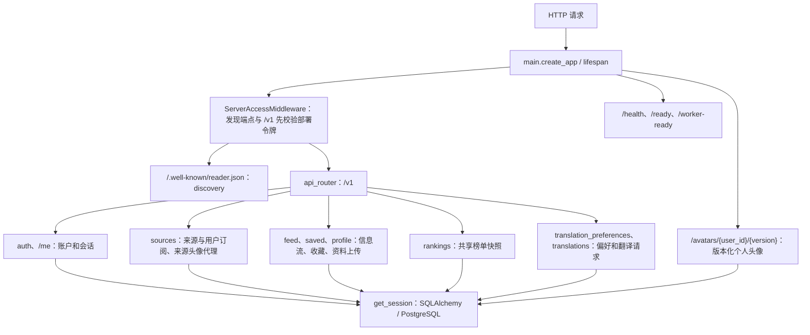

`create_app` 安装部署访问中间件、装配发现路由、版本化路由与独立头像路由；`lifespan` 建立当前 API 进程自己的连接池、`ReaderJWTVerifier`、`AuthService`、翻译资源与限流器。`document_server_token` 只作 OpenAPI 声明，真正校验在路由前的 ASGI `ServerAccessMiddleware`：仅保护发现端点与 `/v1`，不保护 `/avatars`、健康端点；`OPTIONS` 放行。业务路由通过 `get_session` 直接操作 ORM，不存在统一 Repository 或跨进程 RPC。资料上传经 `upload_avatar` 将校验后的图像写入 `ProfileAvatar`，版本化读取由 `get_avatar` 提供；`proxy_source_avatar` 则先核查当前用户订阅，再释放数据库事务并安全代理上游图标，两条媒体路径不能混同。依据：[main.py（`create_app`、`lifespan`）](../backend/src/app/main.py)、[api/router.py（`api_router`）](../backend/src/app/api/router.py)、[core/server_access.py（`ServerAccessMiddleware`）](../backend/src/app/core/server_access.py)、[storage/database.py（`get_session`）](../backend/src/app/storage/database.py)、[api/profile.py（`upload_avatar`）](../backend/src/app/api/profile.py)、[api/avatars.py（`get_avatar`）](../backend/src/app/api/avatars.py)、[api/sources.py（`proxy_source_avatar`）](../backend/src/app/api/sources.py)。

## 部署令牌、用户鉴权与刷新事务

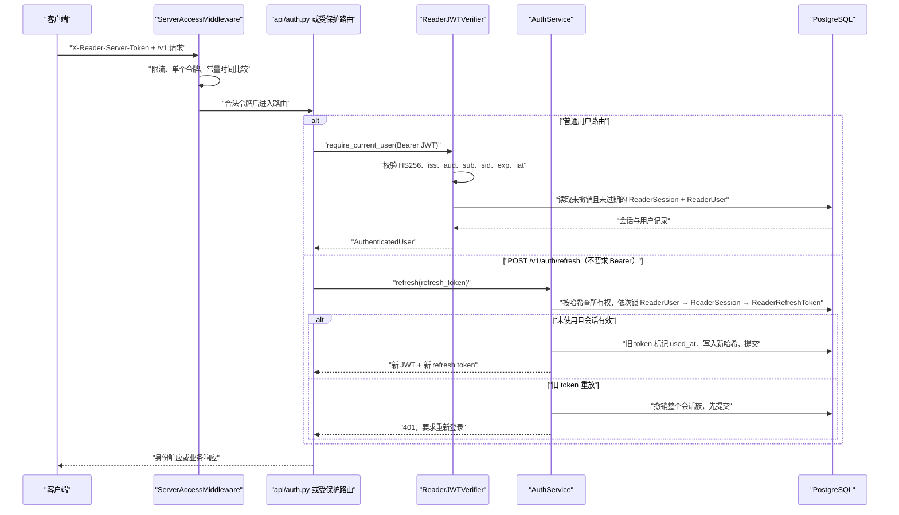

注册／登录由 `AuthService.register`／`login` 创建 `ReaderSession` 与刷新令牌；JWT 包含用户 `sub` 和会话 `sid`。数据库只存刷新令牌 SHA-256 摘要，`refresh` 在同一会话族轮换；`logout` 撤销该族。部署令牌与用户 Bearer 是两道不同校验；刷新以 refresh token 而非 Bearer 校验，注册／登录／刷新还受密码运算限流依赖约束。依据：[api/auth.py（`password_attempt`、`refresh`）](../backend/src/app/api/auth.py)、[core/auth.py（`require_current_user`、`ReaderJWTVerifier.verify`）](../backend/src/app/core/auth.py)、[services/auth.py（`AuthService._lock_refresh`、`refresh`、`_new_tokens`）](../backend/src/app/services/auth.py)、[core/server_access.py](../backend/src/app/core/server_access.py)。

## 订阅事务与来源健康的只读解释

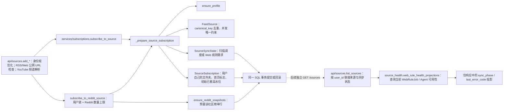

普通订阅与 Reddit 订阅都在服务函数内提交／异常回滚；`_prepare_source_subscription` 对共享来源复用或插入、锁／插入同步状态、按用户去重订阅。新订阅的 `last_viewed_update_sequence` 初始化为来源高水位；Reddit 特有的限额事务锁及 `ensure_reddit_snapshots` 与订阅一同提交。Web 可用 feed 先探测；需要原生规则时写 `web_rule_required` 并排入规则任务，不能把这画成同步完成的扫描。列表的 `web_rule_health_projections` 只解释当前规则修订／失败 episode、任务和 Agent 可用性，不改写扫描证据；来源健康是 SQL 状态的响应投影而非另一个 Worker RPC。依据：[api/sources.py（`add_*_source`、`list_sources`）](../backend/src/app/api/sources.py)、[services/subscriptions.py（`subscribe_to_source`、`subscribe_to_reddit_source`、`_prepare_source_subscription`）](../backend/src/app/services/subscriptions.py)、[services/source_health.py（`web_rule_health_projections`、`project_web_rule_health`）](../backend/src/app/services/source_health.py)。

## 信息流、排行与收藏的数据路径

```mermaid
flowchart LR
    feed["api/feed._query_feed_page"] --> entries["SourceSubscription 用户范围 + SourceEntry + Content"]
    entries --> feedout["按 Content 去重、键集分页、翻译标题投影、UserSavedContent 标记"]
    article["api/feed.get_article"] --> access["活跃订阅或本人已收藏才可读正文"]
    ranking["api/rankings.get_ranking"] --> permission["Reddit 榜单先检查活跃社区订阅"]
    permission --> snapshot["ranking_snapshots.get_snapshot：共享 RankingSnapshot"]
    snapshot -->|"缺失或显式刷新"| refresh["create_or_refresh_snapshot：持久租约、上游 I/O、发布"]
    refresh -->|"仅 Reddit hot 且有活跃订阅"| queue["_enqueue_reddit_hot_admissions → IngestionCandidate"]
    queue -->|"SQL 持久交接；独立租约领取"| worker["Worker.process_candidates：Content + SourceEntry"]
    worker --> entries
    snapshot --> rankingout["_ranking_response：榜单项不等同 Content；只读已有译文"]
    refresh --> rankingout
    rankingout --> save["api/saved.save_ranking"]
    save --> persist["ranking_saved.persist_ranking_item：核对快照中的 URL／Reddit 订阅"]
    persist --> archive["复用或创建 Content + SourceEntry；HN/GitHub 用暂停的共享 archive source"]
    archive --> saved["UserSavedContent(user_id, content_id)"]
    feedout --> regular["api/saved.save_content：权限检查后收藏"]
    regular --> saved
    saved --> savedpage["api/saved._query_saved_page：按用户收藏、来源展示去重与分页"]
```

`get_ranking` 先从共享 SQL 快照读取；缓存不存在或显式刷新才走带持久租约的上游请求（独立 Worker 也调用同一 `sync_due_ranking_snapshots`／`create_or_refresh_snapshot` 源码，在自己的进程实例中执行，不是 API 调 Worker）。发布 Reddit **hot** 快照时，最多前十项转成持久候选；首批是 baseline，随后发现的新条目才计更新，真正的 `Content`／`SourceEntry` 由 Worker 候选处理提交。其他榜单项在仅浏览时不入 `Content`：`save_ranking` 从实际快照按 URL 确认项目，优先复用当前用户可访问的内容，否则物化新条目并写本人 `UserSavedContent`；新物化 Reddit 使用同一社区来源，HN/GitHub 使用不供订阅的归档来源。普通信息流必须经过本人启用的订阅筛选；收藏分页能保留订阅失效后已收藏的内容。依据：[api/feed.py（`_query_feed_page`、`get_article`）](../backend/src/app/api/feed.py)、[api/rankings.py（`get_ranking`、`_ranking_response`）](../backend/src/app/api/rankings.py)、[services/ranking_snapshots.py（`get_snapshot`、`create_or_refresh_snapshot`、`sync_due_ranking_snapshots`、`_publish_snapshot`、`_enqueue_reddit_hot_admissions`）](../backend/src/app/services/ranking_snapshots.py)、[ingestion/candidate_queue.py（`upsert_candidates`）](../backend/src/app/ingestion/candidate_queue.py)、[workers/candidates.py（`process_candidates`）](../backend/src/app/workers/candidates.py)、[api/saved.py（`save_content`、`save_ranking`、`_query_saved_page`）](../backend/src/app/api/saved.py)、[services/ranking_saved.py（`persist_ranking_item`）](../backend/src/app/services/ranking_saved.py)。

## 频道更新高水位与确认游标

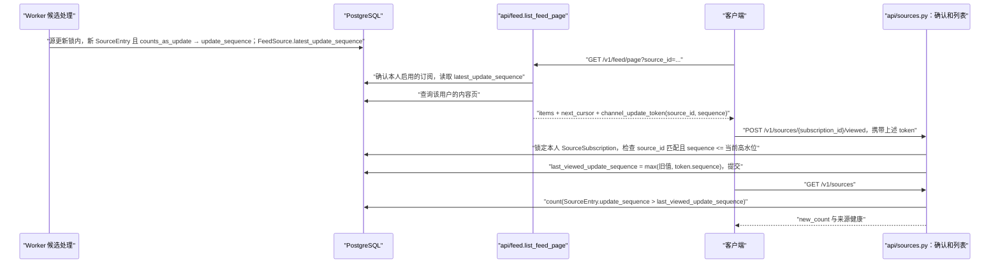

频道 token 仅在指定且已启用的 `source_id` 的 `/feed/page` 中返回；它编码来源和当时的高水位，不是普通 feed 键集分页 cursor，也不是签名的阅读证明。确认接口按用户锁订阅、校验来源／高水位并单调前进，不简单地把确认时刻的最新序号设为已看；新订阅以当时来源高水位为初始已看值。只有候选首次生成条目、标记 `counts_as_update` 且不重复 `Content` 条目时分配更新序号，Reddit hot 首批 baseline 不计新内容。依据：[workers/candidates.py（`_process_candidate`、`_next_source_update_sequence`）](../backend/src/app/workers/candidates.py)、[services/ranking_snapshots.py（`_enqueue_reddit_hot_admissions`）](../backend/src/app/services/ranking_snapshots.py)、[api/feed.py（`list_feed_page`、`_channel_update_snapshot`）](../backend/src/app/api/feed.py)、[api/sources.py（`mark_source_viewed`、`list_sources`、`_decode_channel_update_token`）](../backend/src/app/api/sources.py)、[services/subscriptions.py（`_prepare_source_subscription`）](../backend/src/app/services/subscriptions.py)。

<a id="execution"></a>

## 来源扫描：模块调用与数据去向

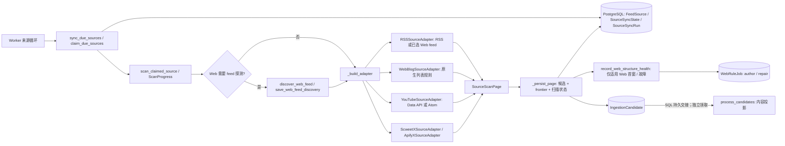

生产态 [run_forever](../backend/src/app/workers/main.py) 的来源扫描与候选处理是独立轮询循环，以 PostgreSQL 候选行为交接，不是扫描器同步调用候选处理器；`run_once` 仅是有界单轮入口。

入口为 [run_once](../backend/src/app/workers/main.py)、[sync_due_sources／scan_claimed_source／_build_adapter](../backend/src/app/workers/sync.py)；adapter 的统一接口是 [SourceAdapter.scan_page](../backend/src/app/ingestion/sources/base.py)，返回 [SourceScanPage](../backend/src/app/ingestion/models.py)。Web 先用 [discover_web_feed](../backend/src/app/ingestion/feed_discovery.py) 和 [save_web_feed_discovery](../backend/src/app/services/web_feeds.py) 判定已选 feed，未确认的临时失败／阻断不等于“没有 feed”。无可用 feed 才用 [WebBlogSourceAdapter.scan_page](../backend/src/app/ingestion/sources/web_blog.py) 的列表规则；它不逐篇运行旧 `article` recipe。YouTube 的 Data API 配额不足可走 Atom；Reddit 首页更新来自排行快照而非此扫描器。`record_web_structure_health` 只在扫描事务内解释结构证据：所选 feed 连续两次首窗结构失效会转重探测；原生规则的首窗结构故障连续两次触发 `repair`，`web_rule_required` 触发 `author`；有有效标题/URL 对的部分解析警告不触发修复。[源码：健康迁移](../backend/src/app/services/web_scan_health.py)。

## 扫描事务、续扫与候选额度

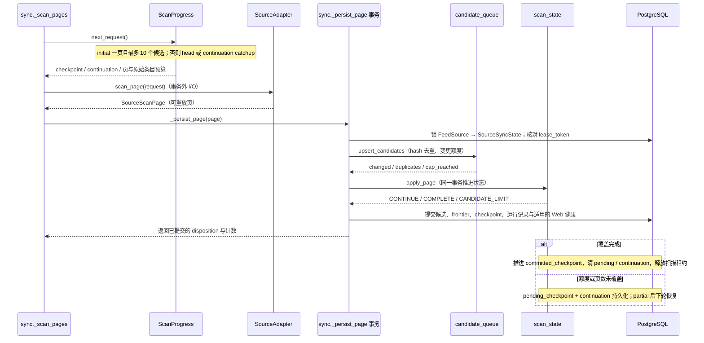

[claim_due_sources／_start_run／_persist_page](../backend/src/app/workers/sync.py) 在上游请求前提交租约；之后每页独立以 **来源→扫描状态** 顺序锁定并验证租约，再把 [upsert_candidates](../backend/src/app/ingestion/candidate_queue.py)、Web frontier、[ScanProgress.apply_page](../backend/src/app/services/scan_state.py) 和 [record_web_structure_health](../backend/src/app/services/web_scan_health.py) 一起提交；scanner I/O 不持有这些锁。`ScanProgress.next_request` 将初扫、更新首窗和历史续扫分开；续扫按 continuation 的 `head_first` 逐轮交替：一轮先执行保存的 tasks 再用剩余预算刷新 head，下一轮反之，避免小预算下历史游标或新内容任一方饿死。未访问的 fresh head 不持久累积，下轮按最新 checkpoint 重新生成；已开始但未完成的 head 则作为持久任务继续。增量候选 cap 命中时 `_cursor_for_incomplete_page` 保留**当前输入页**或从 head 重启以重放，不能提前将 pending 提升为 committed；页数／原始条目达到预算则由 `finish_incomplete_run` 保留续扫并释放租约。非权威 Atom 回退不抹掉权威历史任务；`cursor_invalid` 重启 backlog。[源码：ScanProgress／PageDisposition／record_scan_failure](../backend/src/app/services/scan_state.py)。[reset_for_rule_activation／reset_for_selected_feed／reset_for_feed_rediscovery](../backend/src/app/services/scan_state.py) 清旧端点游标和 pending，仅保留 `head_ids`／`item_hashes` 去重锚点，不重置初扫基线；规则激活还终结旧运行和释放旧租约，而选定 feed 不抢占本轮租约。[源码：_activate_validated_rule](../backend/src/app/services/web_rules.py)。

## 候选队列：显式观察语义到内容投影

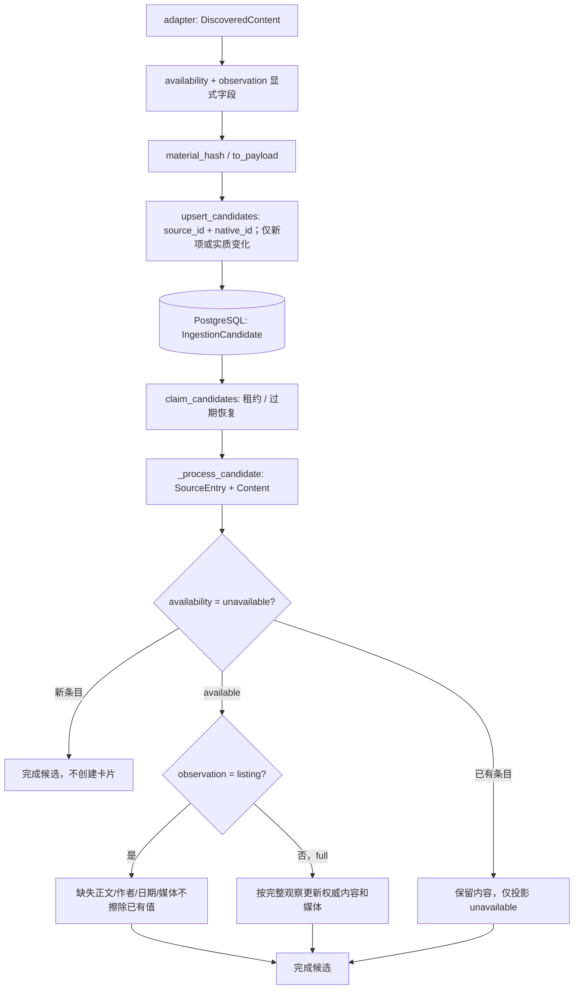

[ContentAvailability](../backend/src/app/ingestion/models.py) 当前只有 `available`／`unavailable`；[ContentObservation](../backend/src/app/ingestion/models.py) 当前只有 `full`／`listing`，不是由 `raw_metadata` 推断消费策略。[WebBlogSourceAdapter._listing_item](../backend/src/app/ingestion/sources/web_blog.py) 产生 `listing`，[YouTubeSourceAdapter._to_content](../backend/src/app/ingestion/sources/youtube_data.py) 对不可用视频产生 `unavailable`。`DiscoveredContent.material_hash` 只为兼容既有队列／checkpoint 哈希编码把显式字段映射成旧哈希材料键，运行时决策不读旧 metadata 标记。[源码：DiscoveredContent](../backend/src/app/ingestion/models.py)。[upsert_candidates](../backend/src/app/ingestion/candidate_queue.py) 对重复哈希不重置候选，首见的 `counts_as_update` 在后续冲突更新时保持；[process_candidates／_process_candidate](../backend/src/app/workers/candidates.py) 在独立事务领取并投影，失败回滚再核对租约后重试。初扫候选在异步消费前持久标记基线；只有后续新内容获得来源更新序号，重复条目、另一上游 ID 指向已有内容及修改不创建新的频道提醒。`listing` 保留已有正文与来源一致的 HTML/text；不可用新条目不建卡、已有条目保留正文，恢复可用可再次更新。标题预热翻译在原文入库后建立工作，不阻塞入库。

[20260925_30 候选语义迁移](../backend/migrations/versions/20260925_30_candidate_semantics.py) 只改已有队列载荷，把旧标记迁到显式字段，保留 `payload_hash`、候选状态、租约、尝试次数和扫描 checkpoint；新运行时要求 `reader-runtime-v26`，旧生产者/消费者不能与新载荷并行读写。

<a id="rule-author"></a>

## 网页规则 Agent：调用与权限归属

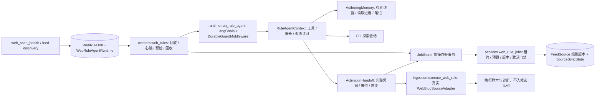

[services.web_rule_jobs.ensure_web_rule_job](../backend/src/app/services/web_rule_jobs.py) 是 Python 函数，不是另一个微服务：API 的 [subscribe_to_source](../backend/src/app/services/subscriptions.py) 与 Worker 的 [record_web_structure_health](../backend/src/app/services/web_scan_health.py) 可在各自进程实例内调用同一源码；只有 PostgreSQL 的 `WebRuleJob` 将意图持久交给独立 Worker 作者循环。图中 Worker／Context／Handoff／Store／持久规则服务之间也是进程内调用，不能画成 HTTP RPC 或消息代理。

[run_web_rule_author_once](../backend/src/app/workers/web_rules.py) 默认仅在规则引擎启用时认领**全局串行**任务，负责快照身份、心跳、旧规则预检、模型生命周期与浏览器释放；预检旧规则成功可无模型调用地取消修复。模型入口 [run_rule_agent／DurableGuardMiddleware](../backend/src/app/web_rule_agent/runtime.py) 串行宿主工具、持久预约和记账模型调用；[RuleAgentContext](../backend/src/app/web_rule_agent/context.py) 管工具、授权页面、展示截断和 [AuthoringMemory](../backend/src/app/web_rule_agent/memory.py) 的证据。模型只提交 `FinalWebRule` 判断（或有证据的失败），不能直接改来源。[ActivationHandoff](../backend/src/app/web_rule_agent/handoff.py) 保存完整执行凭据，模型只看分页、有界展示；[JobStore](../backend/src/app/web_rule_agent/store.py) 无跨模型／网页 I/O 的长事务。最终权限属于 [services.web_rule_jobs 的 _checked／activate_web_rule_job](../backend/src/app/services/web_rule_jobs.py)，不是内存上下文。规则试跑 [ingestion.execute_web_rule](../backend/src/app/ingestion/web_rules.py) 直接运行普通 adapter，最多三窗、每窗最多 15 项；`completed` 是有界运行结果，非内容质量判决；首窗完成是必要门槛，后续失败可为 `partial`。样本**只作为事实／诊断，不直接入队或入库**，成功激活后仍由正常扫描链路发现内容。

## 规则交接：pending、凭据 TTL 与重启恢复

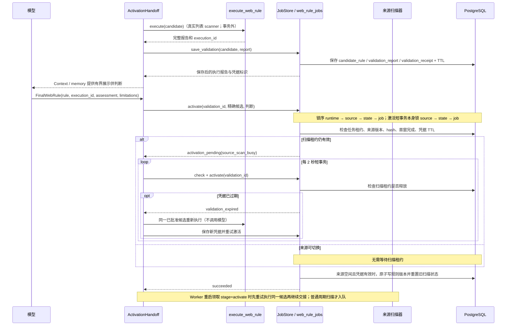

[claim_web_rule_job／heartbeat_web_rule_job](../backend/src/app/services/web_rule_jobs.py) 先锁全局 runtime，再按 source→sync state→job；无 runtime 锁的 [activate_web_rule_job](../backend/src/app/services/web_rule_jobs.py) 与管理激活仅锁后三者，终结任务提交后另行 [release_web_rule_slot](../backend/src/app/services/web_rule_jobs.py)，避免反向加锁。来源变更、版本变化、任务租约丢失、配置快照不匹配都会 fence 旧执行；恢复同一任务不重置 token／模型调用额度。[save_web_rule_validation](../backend/src/app/services/web_rule_jobs.py) 将 receipt 绑定 job、lease token、来源 URL、规则修订、候选 hash、执行器版本和 TTL，只有 `first_window_completed` 才可激活。扫描忙时 [ActivationHandoff.complete／resume](../backend/src/app/web_rule_agent/handoff.py) 以短事务轮询，过期则**同一候选重新试跑**，重启 `activate` 阶段先重新执行；不再问模型、不把历史执行或已裁剪的展示当成当前授权。激活时 [_activate_validated_rule](../backend/src/app/services/web_rules.py) 原子换规则与重置旧扫描端点状态。未配置或默认禁用 Agent 时，不应把此流程画成每个 Web 源的常驻模型路径。

<a id="browser-tasks"></a>

## 浏览器控制面、数据面与隔离边界

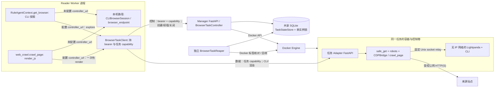

选择点是 [RuleAgentContext.get_browser](../backend/src/app/web_rule_agent/context.py) 和 [web_crawl.crawl_page](../backend/src/app/ingestion/web_crawl.py) 的 `render_js` 分支；**静态页面**仍经 `PublicHTTPStrategy` 的 HTTP 路径，不创建浏览器任务；无正常 Chromium 自动回退。本机探索由 [CLIBrowserSession](../backend/src/app/web_rule_agent/cli_browser.py) 保留一任务内 CLI＋[CDPBridge](../backend/src/app/web_rule_agent/cli_bridge.py)＋[browser_endpoint](../backend/src/app/ingestion/browser_runtime.py) 的 Lightpanda，bubblewrap 隔离；动态试跑／周期扫描另起独立 render endpoint，不改变探索会话。容器路径 [BrowserTaskClient／RemoteCLIBrowserSession／render_page_with_browser_task](../backend/src/app/browser_tasks/client.py) 则以 runtime fingerprint 请求 `explore` 或一次性 `render`，Worker 只获得 adapter endpoint、capability，不访问 Docker socket。[manager_app.create_app](../backend/src/app/browser_tasks/manager_app.py) 校验控制 bearer，[BrowserTaskController._create_resources](../backend/src/app/browser_tasks/controller.py) 建控制卷、初始化容器、无 IP 网络 browser、独立 adapter；[AdapterRuntime](../backend/src/app/browser_tasks/adapter_runtime.py) 校验 capability/task/purpose，并在 adapter 侧经固定 Unix socket relay、`safe_get` 与 robots 控制页面传输。browser 无原生联网能力；adapter 经受限公网校验对站点请求，CLI 的可导航 URL 只从最终已展示证据授权。Manager 与 [BrowserTaskReaper](../backend/src/app/browser_tasks/reaper.py) 共用本地 SQLite 生命周期事实及 Docker 标签回收，但只有 Manager 持控制 bearer／capability HMAC key；Reaper 不开放模型／页面接口。[协议：TaskPurpose／RuntimeIdentity](../backend/src/app/browser_tasks/protocol.py)。

`RuleAgentContext` 只从最终交付的同源链接累积导航许可，接纳时同时遵守 `browser_tasks.protocol` 的 `MAX_OBSERVED_URLS` 和 `MAX_OBSERVED_URL_CHARS`。总字符按协议 URL 规范化后的表示计数，重复观察不重复占额度；超限链接不授予导航许可，后续命令的 `observed_urls` 保持可编码。

## 浏览器任务生命周期（仅配置容器模式）

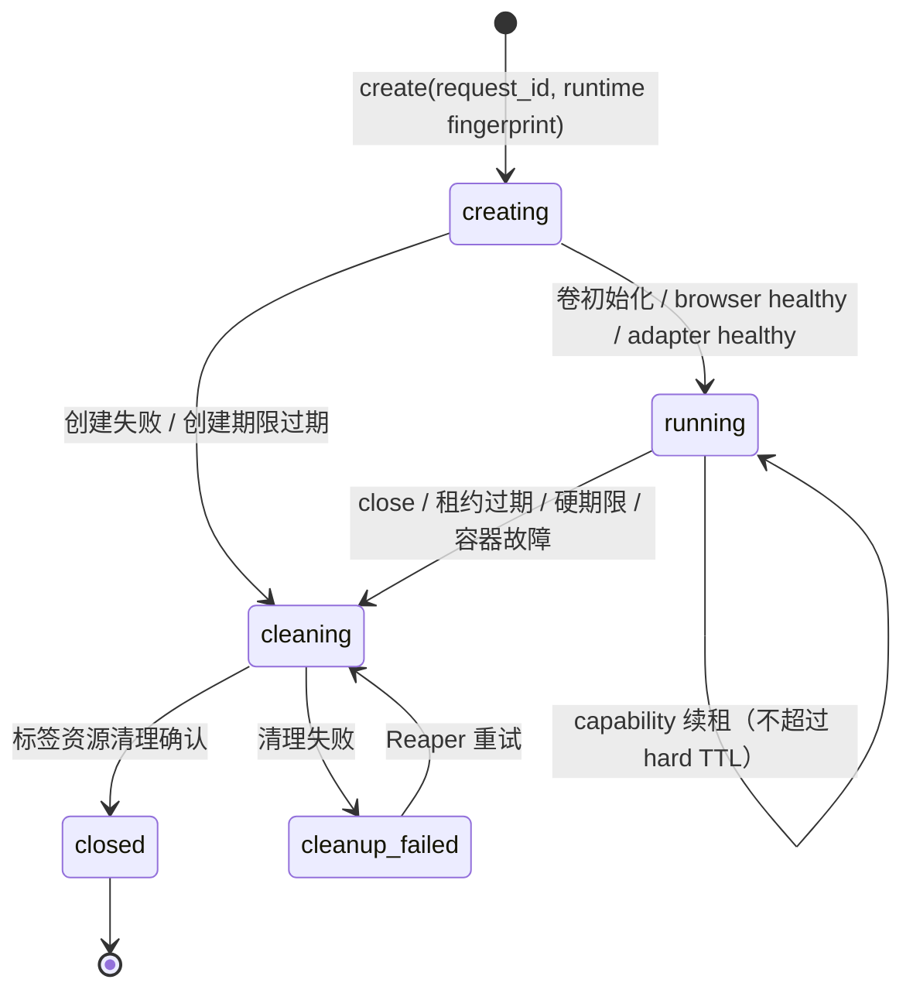

[TaskStateStore.reserve／transition／renew／claim_cleaning／finish_cleanup](../backend/src/app/browser_tasks/state.py) 用 SQLite 短事务、版本 CAS 与 `request_id` 幂等保护控制状态；容量计算同时覆盖未确认释放的资源，`max_explore_tasks` 留出 render 槽。[BrowserTaskController._create／close](../backend/src/app/browser_tasks/controller.py) 将 Docker 外部工作放在状态事务外；任务 `creating` 时按阶段持久更新，只有两容器健康才 `running`。Worker 的 [BrowserTaskSession._heartbeat／_run_guarded／aclose](../backend/src/app/browser_tasks/client.py) 续租／失败后停止使用并尽力关闭；Manager 显式 close 与 [BrowserTaskReaper.run_once](../backend/src/app/browser_tasks/reaper.py) 对硬期限、租约宽限、资源缺失/故障、残留标签资源以竞争 `claim_cleaning` 分工回收。SQLite 暂不可用时 Reaper 只凭不可变标签事实和硬期限等安全条件回收，不凭页面内容推断任务身份。

Reaper 将不完整资源集合判为 `resource_set_changed` 前，按任务标签重新列举资源、检查容器，并确认 SQLite 状态版本未变；初次 Docker 快照可能早于 `creating` → `running`。确认失败或版本变化则留待下一轮，真实缺失仍按既有 CAS 清理；仅重新 inspect 已知容器不能补上初次快照遗漏的资源。

`BrowserTaskSession._run_guarded` 拥有单次 adapter 操作：操作结束、外层取消或续租监控失败后，必须取消尚未完成的操作并等待其清理，消费已完成任务的异常。共享 heartbeat 属于整个浏览器会话，不随单次操作取消；由会话关闭回收。

<a id="translation"></a>

## 翻译：模块依赖与实例归属

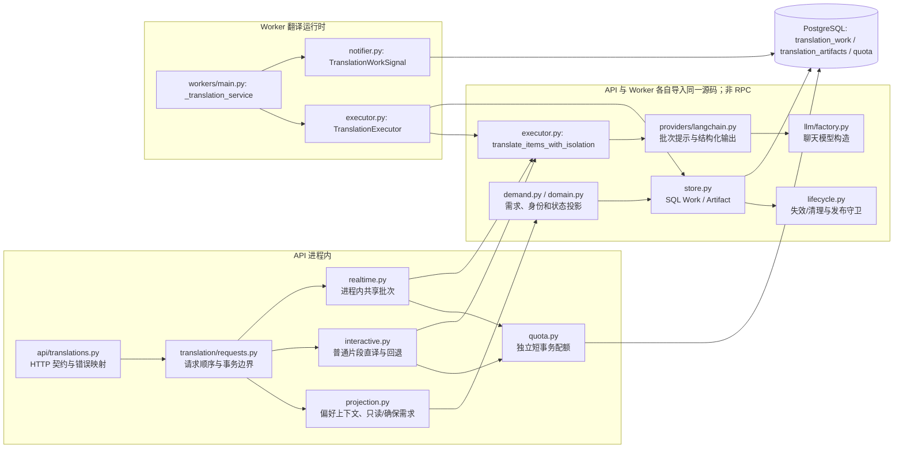

[路由](../backend/src/app/api/translations.py)只负责输入/响应与异常映射；后重构的请求所有权在 [resolve_accessible_titles、resolve_segments](../backend/src/app/translation/requests.py)，而不是路由或 `projection.py`。后者的 `read_*` 只读、`ensure_*` 创建缺失需求，本身不提交事务；[resolve_translation_demands](../backend/src/app/translation/demand.py) 通过 [store.py](../backend/src/app/translation/store.py) 取得 Artifact 优先的投影。`TranslationDemand.identity` 组合用途、作用域/所有者、规范化文本哈希、语言与引擎指纹；富文本加入格式版本，用户临时片段还加入偏好代次。[domain.py](../backend/src/app/translation/domain.py)；[rich_text.py](../backend/src/app/translation/rich_text.py)。图中的共享源码不是独立部署服务：API `lifespan` 构建按 `engine_id` 索引的适配器与一个 `RealtimeCoordinator`；Worker `_translation_service` 构建按精确 `engine_fingerprint` 索引的适配器及前台/后台两个 `TranslationExecutor` 实例。[main.py](../backend/src/app/main.py)、[factory.py](../backend/src/app/translation/factory.py)、[workers/main.py](../backend/src/app/workers/main.py)。

## 翻译：标题、普通片段与实时片段的决策

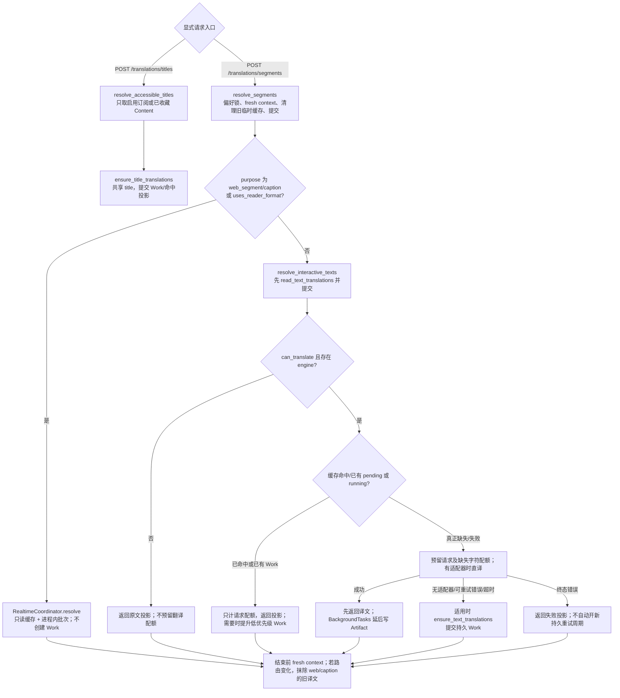

标题路径校验访问范围、去重、以请求顺序返回可访问项并提交需求；其他内容读取也直接调用 `ensure_title_translations`，而排行响应可只读投影。[requests.py](../backend/src/app/translation/requests.py)、[projection.py](../backend/src/app/translation/projection.py)、[feed.py](../backend/src/app/api/feed.py)、[rankings.py](../backend/src/app/api/rankings.py)。普通显式片段的可重试失败/超时才按条件建立持久回退；已有终态失败在本次请求内仅再尝试直译一次，超时不会暗中续启无界 Worker 重试。[resolve_interactive_texts](../backend/src/app/translation/interactive.py)。`resolve_segments` 通过 `defer=background_tasks.add_task` 延后普通成功 Artifact 的最佳努力写入，**不是**延后所有 SQL：偏好读取/清理、普通缓存投影/Work 回退以及 [TranslationQuotaStore.reserve](../backend/src/app/translation/quota.py) 各按自己的事务/提交时机执行。实时成功由协调器自己的 runner 在投影 future 结算后写 Artifact，不通过这条普通片段的 `BackgroundTasks`。[api/translations.py](../backend/src/app/api/translations.py)、[realtime.py](../backend/src/app/translation/realtime.py)。

普通翻译 provider 用 `TaskGroup` 管理内部子批次：任一子批次失败会取消并等待其余模型请求，全部成功时按输入批次顺序组装结果；任务组不能向上泄漏 `ExceptionGroup` 替代既有 `TranslationProviderError` 的错误码与重试信息。请求取消同样收拢 provider 内部工作，不留下无人消费的模型调用。

`resolve_segments` 的数据库超时边界覆盖请求准备、执行以及交付前最后一次 fresh context 查询和提交，统一转换为 `TranslationStorageBusy`，由 HTTP 层返回既有 `503 / translation_storage_busy`；最终偏好检查失败时不交付已取得的译文，也不暴露数据库内部错误。

## 翻译：实时共享、取消与偏好栅栏

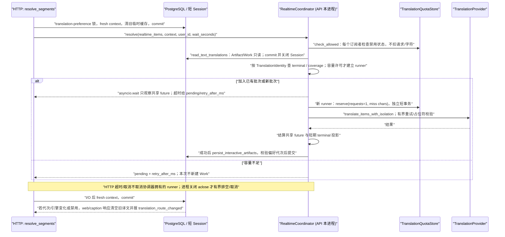

`_coverage` 为本进程相同身份的请求合并，`_terminal` 短暂复用结果，`_owned_tasks` 与容量计数属于协调器；进程重启不恢复在途 runner。只有新批次预留 `requests=1` 与实际缺失字符；加入者也执行 `check_allowed`，纯缓存命中不扣缺失字符；配额是 PostgreSQL 固定 UTC 分钟窗口中的用户请求、用户实际缺失字符及全局供应商缺失字符三个维度，不应称模型 token 预算。[RealtimeCoordinator.resolve、_execute_batch、aclose](../backend/src/app/translation/realtime.py)、[TranslationQuotaStore.reserve](../backend/src/app/translation/quota.py)。[update_translation_preference](../backend/src/app/api/translation_preferences.py) 持相同用户偏好事务锁，清理临时缓存并取消未领取的私有旧路由 Work；`persist_translation_artifacts` 在发布前重新获取锁核对引擎指纹与偏好代次，避免 A→B→A 回摆时旧结果落库；共享标题/摘要成果另由来源引用守卫保护。[lifecycle.py](../backend/src/app/translation/lifecycle.py)、[store.py](../backend/src/app/translation/store.py)。

## 翻译：持久 Work 领取、外部 I/O 与通知

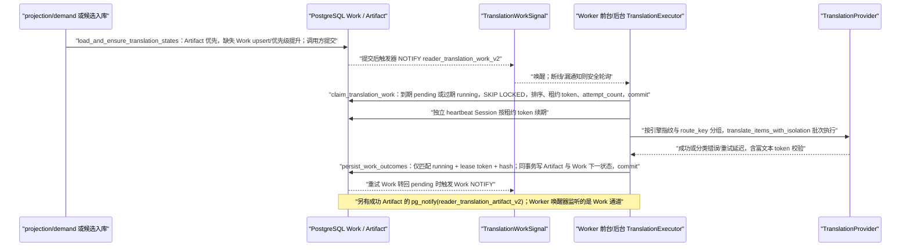

Worker 翻译资源与摄取循环独立监管；前台 lane `priority >= PREFETCH`，后台 lane `priority < PREFETCH`，两者消费同一 SQL 队列且路由仅限已构建的引擎指纹。[workers/main.py](../backend/src/app/workers/main.py)、[TranslationExecutor.run_once_with_session](../backend/src/app/translation/executor.py)。领取提交租约后才做模型 I/O；`persist_work_outcomes` 核对租约、防旧 Worker 覆盖，并按结果置 `succeeded`、可重试的 `pending` 或 `failed`，不是额外消息队列。Worker 可持有 autocommit 连接对象贯穿循环，heartbeat 另开短 Session；不要概括为所有 I/O 都处于一个数据库事务中。[store.py](../backend/src/app/translation/store.py)、[workers/main.py](../backend/src/app/workers/main.py)。Work 通知由数据库 [触发器迁移](../backend/migrations/versions/20260803_11_translation_work_notify.py) 在插入或待处理状态/优先级/可用时间变化时产生；[notifier.py](../backend/src/app/translation/notifier.py) 仅为加速唤醒，持久性来自 Work，安全轮询仍有效。`purge_translation_cache` 清除过时共享引用/引擎和过期临时缓存，临时 Artifact 读时也检查 60 分钟期限；清理顺序 Work 先于 Artifact。[lifecycle.py](../backend/src/app/translation/lifecycle.py)、[store.py](../backend/src/app/translation/store.py)。

## 模型构造与 Codex 凭据刷新归属

```mermaid
flowchart LR
  api["API: build_translation_providers<br/>按 engine_id"] --> adapter["LangChainChatModelProvider<br/>提示词/结构化批次/并发"]
  worker["Worker: build_translation_provider_routes<br/>按 engine_fingerprint"] --> adapter
  agent["可选 Web 规则 Agent"] --> llm["llm/factory.py: build_chat_model<br/>仅构造模型/配置/关闭"]
  adapter --> llm
  llm -->|"DeepSeek / OpenRouter 可用时"| ext["供应商模型"]
  llm -->|"Codex 订阅可用时，仅翻译"| codex["CodexSubscriptionModel"]
  codex --> auth["codex_auth.subscription_headers<br/>Reader 私有文件 + 跨进程 FileLock"]
  auth -->|"临期或首次 401，锁内重读并刷新"| oauth["OAuth token endpoint"]
  codex -->|"完整 SSE response.completed 才交结果"| responses["Codex Responses endpoint"]
```

[translation/factory.py](../backend/src/app/translation/factory.py) 选择可用 catalog engine 并构建适配器；[providers/langchain.py](../backend/src/app/translation/providers/langchain.py) 管翻译提示词、拆批、结构化输出与供应商错误分类，[llm/factory.py](../backend/src/app/llm/factory.py) 只构建模型、不决定翻译需求或规则 Agent 的任务预算。Codex 路径在 [codex_subscription.py](../backend/src/app/llm/codex_subscription.py)，首次 401 可带被拒 token 再取一次凭据；[codex_auth.py](../backend/src/app/llm/codex_auth.py) 将管理员显式导入的专用登录放在 Reader 私有文件，API/Worker 共用文件锁、重新读取同伴轮换结果、先写 pending 标记再刷新并原子替换文件；不读取或改写 Codex CLI 自身凭据库。失败/不确定刷新记录状态防止重复消费单次 refresh token。Codex catalog 可用性是本地检查，不代表每次调用都无需刷新；没有配置密钥/登录时对应引擎不可用，不可画成始终启用。[engines.py](../backend/src/app/translation/engines.py)。

<a id="operations"></a>

## 运行资源：API 生命周期与三类就绪信号

```mermaid
sequenceDiagram
    participant P as API lifespan
    participant S as 进程级服务实例
    participant D as PostgreSQL
    participant R as ReadinessProbe
    participant H as 运维探针
    P->>S: 创建部署访问限流器
    P->>D: 配置存在时创建 engine / session_factory
    P->>S: 创建模型适配器、JWT verifier、AuthService、密码与头像限流器
    P->>S: 创建配额 Store、RealtimeCoordinator
    P->>R: prime 配置及 schema 检查；失败记日志
    Note over P,R: 启动 warm-up 未完成不等于 /ready 成功；并发探针合并，有缓存与超时
    H->>P: GET /health
    P-->>H: API 进程存活
    H->>R: GET /ready
    R->>D: 运行配置和 schema contract 检查
    R-->>H: ready 或 503 failures
    H->>P: GET /worker-ready
    P->>D: load_worker_readiness 读取持久心跳
    P-->>H: Worker 独立报告或 503
    P->>R: 退出时关闭未完成的 readiness refresh
    P->>S: 有界关闭实时 runner、模型适配器、JWT verifier
    P->>D: dispose engine
```

`/health` 不证明数据库或 Worker 可用；`/ready` 也不等价于外部模型供应商的实际调用验收。Worker 心跳是独立持久证据，自动规则作者停用等可选能力不能直接画成整个应用宕机。新候选载荷要求 `reader-runtime-v26`；部署切换须停旧写入者、迁移后启动新版，详见[部署说明](deployment.md#4-启动-api-与-worker)。

源码：[API `lifespan/create_app`](../backend/src/app/main.py)、[`RuntimeReadinessProbe`](../backend/src/app/storage/schema.py)、[`load_worker_readiness/summarize_worker_readiness`](../backend/src/app/workers/health.py)。

## 维护事务：内容保留、孤立来源与翻译清理

```mermaid
flowchart TD
    Loop["_run_cleanup / 一个 Session"] --> Lock["lock_shared_lifecycle<br/>与结果发布共用事务锁"]
    Lock --> Cancel["cancel_obsolete_model_work<br/>有界取消过时路由 Work；活跃租约保留"]
    Cancel --> Retain["purge_retained_contents<br/>按来源保留最新内容；所有用户收藏受保护"]
    Retain --> Orphan["锁定空来源候选：FOR UPDATE SKIP LOCKED<br/>新 DELETE 语句重查订阅、收藏与 Content；有界处理"]
    Orphan --> Cache["purge_translation_cache<br/>依据有效引用与临时缓存生命周期"]
    Cache --> Commit["purge_orphan_sources 提交同一事务"]
    Save["任意用户收藏"] -.->|"阻止删除"| Retain
    Publish["Artifact 发布 / 候选投影"] -.->|"同一生命周期锁协调"| Lock
```

取消订阅不删除收藏；内容清理与翻译清理必须同时尊重引用和租约。清理不是无条件级联清空，也不是抓取失败后的补偿重试。`Content` 的来源归属和收藏保护由 SQL 条件、锁及外键共同约束。

孤立来源回收先跳过被其他事务锁住的来源，再持有来源行锁，用独立 DELETE 语句的新 READ COMMITTED 快照复查引用。订阅用例先锁来源再插入订阅；因此未提交订阅使本轮清理跳过该来源，在候选查询快照建立后、加锁前提交的订阅则由删除前复查保护，不能依赖单条 DELETE 内重复谓词防止级联误删。

源码：[`_run_cleanup`](../backend/src/app/workers/main.py)、[`cancel_obsolete_model_work/purge_orphan_sources`](../backend/src/app/workers/cleanup.py)、[`purge_retained_contents`](../backend/src/app/workers/content_retention.py)、[翻译生命周期](../backend/src/app/translation/lifecycle.py)。

## 按模块定位与维护图谱

| 模块 | 本图谱覆盖 | 继续深入的源码入口 |
| --- | --- | --- |
| `main.py / core / api` | 进程资源、认证、HTTP 组合、用户业务 | [入口](../backend/src/app/main.py)、[路由装配](../backend/src/app/api/router.py)、[核心配置](../backend/src/app/core/settings.py) |
| `services` | 订阅事务、来源健康、排行与收藏、扫描健康及规则持久授权 | [业务服务目录](../backend/src/app/services/) |
| `domain` | 共享枚举；X 关系规范化、合并与预览 | [X 关系](../backend/src/app/domain/x_relations.py) |
| `ingestion / workers` | adapter、分页进度、候选载荷／投影、后台监督及清理 | [扫描](../backend/src/app/workers/sync.py)、[候选](../backend/src/app/workers/candidates.py)、[协议类型](../backend/src/app/ingestion/models.py) |
| `web_rule_agent` | 模型工具／证据、宿主交接与可恢复激活 | [Context](../backend/src/app/web_rule_agent/context.py)、[Handoff](../backend/src/app/web_rule_agent/handoff.py) |
| `browser_tasks` | 控制面、任务数据面、共享状态、隔离与回收 | [内部契约](../backend/src/app/browser_tasks/protocol.py)、[控制器](../backend/src/app/browser_tasks/controller.py) |
| `translation / llm` | 请求分流、实时共享、持久执行、配额、模型适配及凭据 | [请求入口](../backend/src/app/translation/requests.py)、[模型工厂](../backend/src/app/llm/factory.py) |
| `storage / migrations` | 账户、来源归属、持久状态、租约、就绪契约 | [ORM](../backend/src/app/storage/models.py)、[账户模型](../backend/src/app/storage/auth_models.py)、[迁移](../backend/migrations/) |
| `admin / scripts` | 运维用户、配额、规则与独立 Codex 凭据；接口导出／迁移辅助 | [reader-admin](../backend/src/app/admin/cli.py)、[脚本目录](../backend/scripts/) |

`UserContentState` 在持久模型中存在，但当前 API 路由没有读写该表的阅读状态接口；ER 中出现该表不等于向客户端承诺了相应功能。管理和规则诊断命令复用既有服务；模型输出、诊断样本与已激活规则是不同的状态，不能混同。

结构边界变化同步 [workspace.dsl](../architecture/workspace.dsl)；事务、状态或符号变化同步本文对应图及[架构说明](ARCHITECTURE.md)。图中列出的是关键实现路径，完整参数、错误条件和表字段继续以源码、迁移与接口定义为准。
